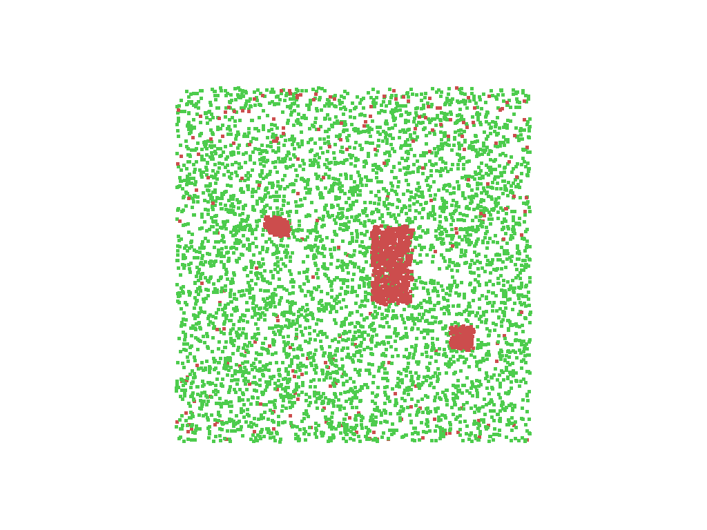

# 3D Perception Tour with Open3D — seven scripts for the LiDAR point-cloud pipeline, with headless tests and CI

[](https://github.com/hurjun/open3d/actions/workflows/ci.yml)


Seven small Python scripts walk the classic 3D point-cloud pipeline end to end. The steps: filter, find the ground, cluster objects, align two scans, build and check a mesh, read LiDAR `.las` files. Each script prints numbers and renders a figure. Built on [Open3D](https://www.open3d.org/), `laspy` and `trimesh`. This is a learning project (not a fork of Open3D, not novel research).



*Stage 3, synthetic driving scene (top-down): green = RANSAC ground inliers, red = non-ground objects.*

## Result

- Voxel filter on the Stanford Bunny (`voxel_size=0.005`): 100,000 → ~3,130 pts (~96.9% reduction).
- RANSAC + DBSCAN on a seeded synthetic driving scene: ground normal ≈ (0.00, 0.00, 1.00); 3 clusters found.
- Mesh QA reports the Bunny is not watertight: 223 boundary edges, winding consistent, 1 component.
- Five headless tests plus `ruff` run on every push in GitHub Actions.

Numbers are from a single run with no saved log. Open3D's sampler, RANSAC and DBSCAN are unseeded, so Bunny and Stage 3 counts drift a few percent. Stage 7 is exactly reproducible. Full per-stage table: [docs/DETAILS.md](docs/DETAILS.md#results).

## How it works

| Stage | Script | What it does |
|------:|--------|--------------|
| 1 | `day1_pointcloud_basics.py` | Voxel downsample (grid-average points), then PCA normals (local surface directions) |
| 2 | `day2_outlier_removal.py` | Statistical vs. radius outlier removal on a noisy Bunny |
| 3 | `day3_ransac_dbscan.py` | RANSAC fits the ground plane; DBSCAN clusters the rest |
| 4 | `day4_icp.py` | ICP (point-to-point vs. point-to-plane) aligns two scans |
| 5 | `day5_mesh_reconstruction.py` | Poisson reconstruction turns a cloud into a mesh; trims low-density junk |
| 6 | `day6_trimesh_basics.py` | Mesh checks: watertight, winding (face orientation agrees), boundary edges, components |
| 7 | `day7_laspy_basics.py` | Write and read a LAS 1.4 file with ASPRS classes (standard LiDAR labels) and intensity |

Stages 1, 2, 4, 5, 6 use the Stanford Bunny. Stages 3 and 7 use a seeded synthetic scene (ground plane plus boxes), no download needed. `o3d_utils.py` holds shared helpers. `tests/test_smoke.py` checks invariants (facts that must always hold) on a tiny in-memory scene.

## Run it

```bash
python3.10 -m venv .venv
source .venv/bin/activate            # Windows: .venv\Scripts\activate
pip install -r requirements.txt -r requirements-dev.txt
python day3_ransac_dbscan.py                                # opens viewer windows; Q = next
python day3_ransac_dbscan.py --headless --out-dir figures   # no display; writes PNGs
pytest -q && ruff check .
```

Python 3.10 required. The first Bunny run downloads the Bunny (~3 MB) into `~/open3d_data`.

## Limitations

- Stage 4 ICP aligns an exact copy of the target (no noise, full overlap). Its fitness 1.0 is a sanity check, not a result.
- One run, no saved log; several stages are unseeded.
- Data is the Stanford Bunny or synthetic scenes. No real LiDAR tile is used.
- Not implemented: a real public LiDAR tile, noisy or partial-overlap ICP, per-stage timing benchmarks.

## Why it matters for my research

Perception is the first layer where a robot can fail silently. Stage 6 runs explicit pass/fail checks a mesh must satisfy before simulation use. The tests check invariants on a seeded synthetic scene, not saved reference images. These are the habits I want to bring to simulation-based validation and cross-layer fault diagnosis of cyber-physical systems.

## More

- [Details](docs/DETAILS.md): full results table, per-stage notes with all 12 figures, headless rendering, references.
- [Open3D tutorials](https://www.open3d.org/docs/release/tutorial/)

## License

MIT — see [LICENSE](LICENSE).

— Jun Hur · [portfolio](https://hurjun.github.io) · [KCC 2024 paper](https://hurjun.github.io/asset/kcc2024-kiise-nursing-record-paper.pdf) · hurjun96@gmail.com
