# Details — 3D Perception Tour with Open3D

Longer material moved out of the main [README](../README.md): why the project exists, each stage explained with its figures, the full results caveats, headless rendering, repository layout, relevance to robotics, what is not done, and references.

## Why this exists

Voxel filtering, PCA normal estimation, RANSAC plane fitting, DBSCAN clustering, ICP registration, Poisson surface reconstruction, mesh quality validation and `.las` LiDAR I/O are the building blocks under SLAM, mapping and 3D object detection in robotics. I built this to work through each one in code rather than just reading about it. Every script is small enough to read in one sitting. The comments explain the math and the trade-offs, not just the API calls. Each stage ends with a short "takeaways" block.

The stages are independent on purpose. Any one can be run, read or modified on its own.

Stages 1, 2, 4, 5 and 6 operate on the **Stanford Bunny** (Open3D's built-in benchmark mesh). Stages 3 and 7 use a **synthetic, seeded driving scene** (ground plane plus boxes) generated in code, so they run with no external download.

## Stage details

The scripts keep their original `dayN_*.py` file names. "Stage N" below refers to `dayN_*.py`.

### Stage 1 — Point cloud basics (`day1_pointcloud_basics.py`)

Convert the Bunny mesh to 100k points. **Voxel-downsample**: split space into cubes of edge `voxel_size` and replace each cube's points by their centroid. Then **estimate normals**: fit a local plane to each point's neighbours with PCA and point the normal toward a virtual camera to fix its sign.
Key params: `voxel_size=0.005`, normal search `radius=0.01`, `max_nn=30`.

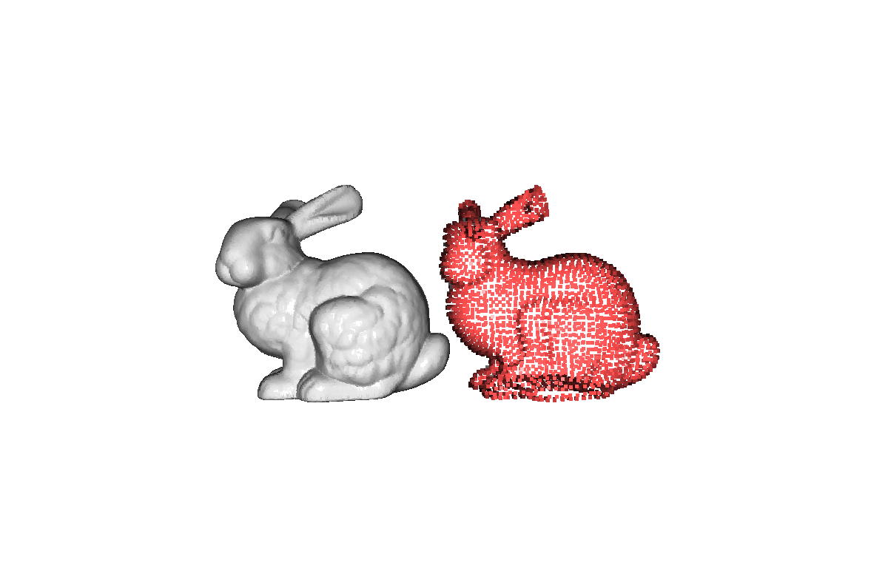

*Original (grey, 100k pts) vs. downsampled (red, ~3.1k pts) side by side.*

### Stage 2 — Outlier removal (`day2_outlier_removal.py`)

Add 500 uniformly random noise points, then compare two denoisers. **Statistical** removal drops points whose mean neighbour distance exceeds `global_mean + std_ratio·σ`. **Radius** removal drops points with fewer than `nb_points` neighbours inside `radius`. The statistical method uses the global distribution. The radius method uses local density and tends to be stricter on the uneven density of real LiDAR.

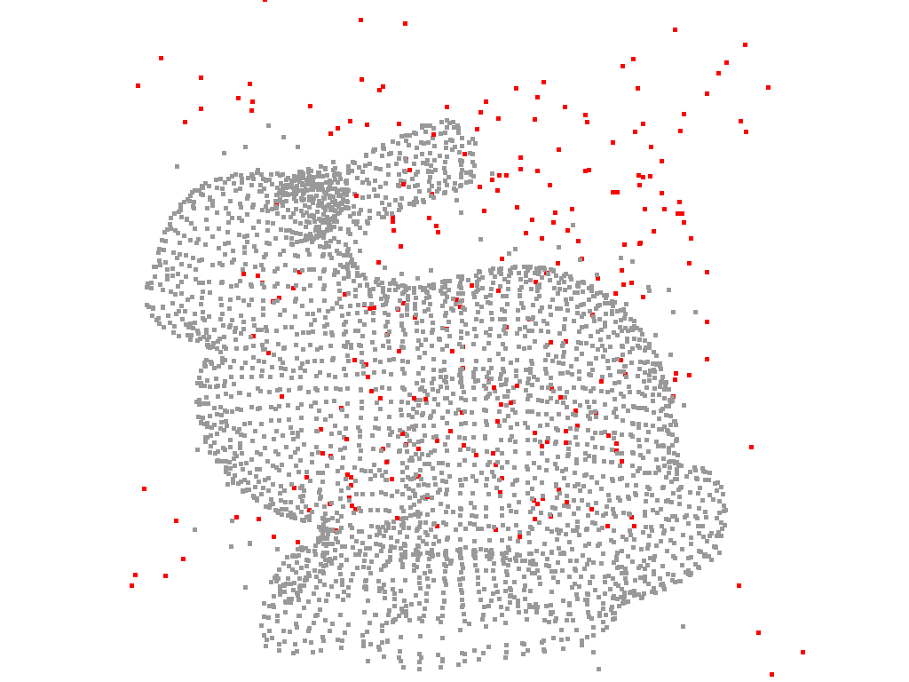

*Statistical outlier removal on the noisy Bunny: grey = kept inliers, red = removed outliers (mostly the injected off-surface noise points).*

### Stage 3 — RANSAC ground segmentation + DBSCAN clustering (`day3_ransac_dbscan.py`)

These are the first two steps of LiDAR object detection. **RANSAC** repeatedly samples 3 points, fits a candidate plane, and counts inliers within `distance_threshold`. The best plane over `num_iterations` is the ground; its normal comes out ≈ +z. Removing the ground leaves the objects. **DBSCAN** groups them by density without knowing the object count in advance (label `-1` = noise).

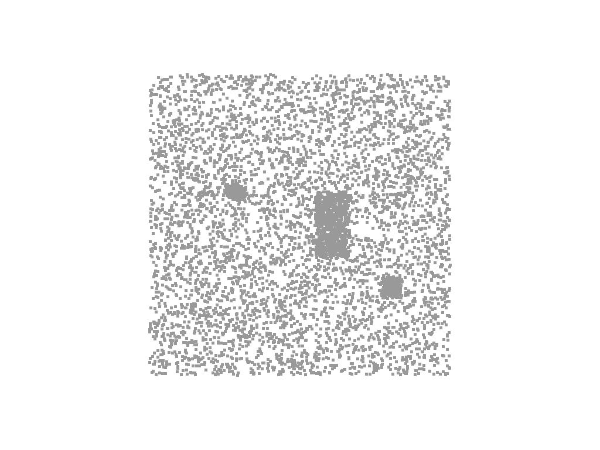

*Raw synthetic scene before segmentation (top-down): a dense ground plane with three box-shaped objects resting on it.*

 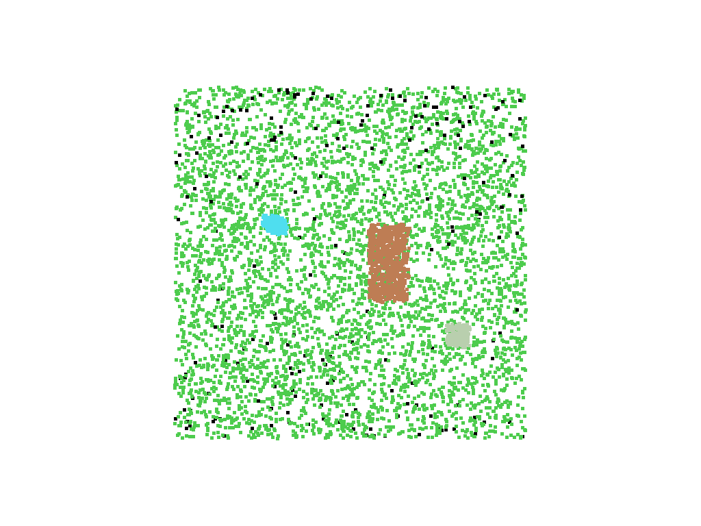

*Left: green = ground inliers, red = non-ground. Right: DBSCAN colours each object cluster (black = noise).*

### Stage 4 — ICP registration (`day4_icp.py`)

Build a `source` cloud by translating and rotating the `target` by 15°, then recover the alignment with **ICP**. **Point-to-point** minimises distance between matched point pairs. **Point-to-plane** minimises distance to the target surface (using normals) and usually converges faster. Reported metrics: `fitness` (matched-point ratio, 1.0 = best) and `inlier_rmse` (mean matched-pair error).

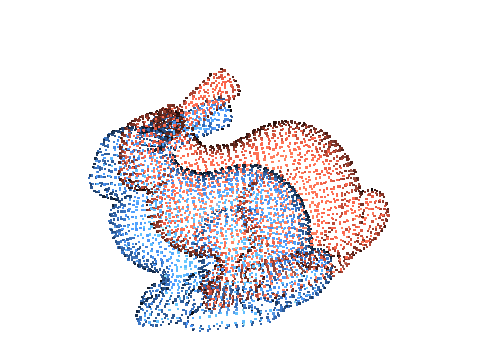 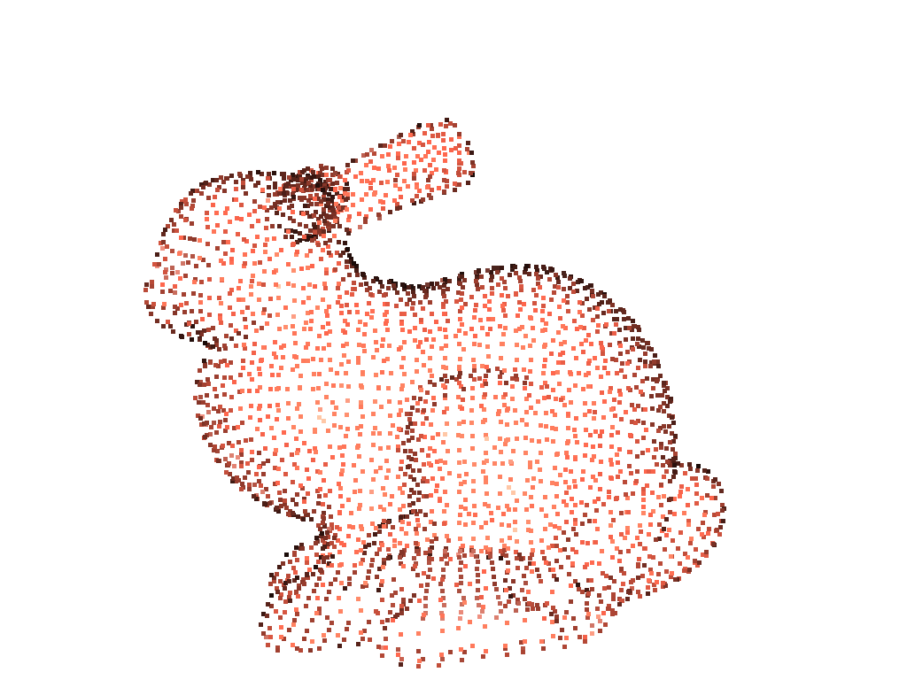

*Left: before ICP, the red source is offset and rotated from the blue target. Right: after point-to-plane ICP the source lands back on the target.*

**Note on Stage 4:** the source cloud is an *exact* rigid transform of the target (offset `tx=0.05, ty=0.03, tz=0.01`, rotation 15°, no added noise or partial overlap). So ICP recovers the alignment perfectly: point-to-point ICP gives fitness 1.0000, rmse 0.000000, and point-to-plane ICP gives the same. On real, noisy, partially overlapping scans you would expect fitness < 1 and point-to-plane to beat point-to-point. This controlled setup is the warm-up for that harder regime.

### Stage 5 — Poisson surface reconstruction (`day5_mesh_reconstruction.py`)

**Poisson reconstruction** solves for a smooth inside/outside function (the indicator function) whose gradient matches the cloud's oriented normals. The result is a watertight mesh. Because it can invent surface far from the real samples, the per-vertex `density` output is used to **trim the lowest-density 5%** of vertices.
Key param: octree `depth=9` (higher = finer, slower).

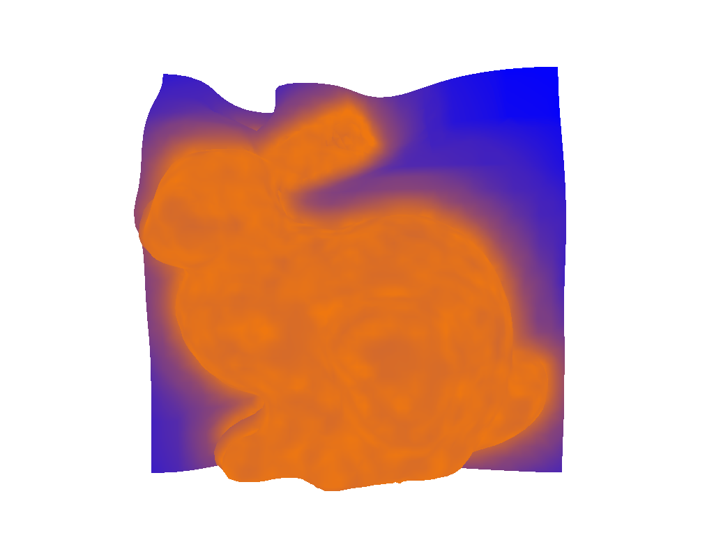 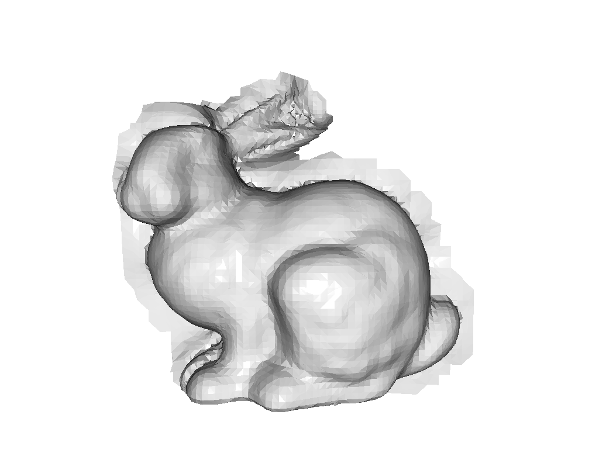

*Left: raw Poisson mesh coloured by vertex density (blue = low/spurious, yellow = high). Right: final mesh after trimming low-density vertices.*

### Stage 6 — Mesh quality validation (`day6_trimesh_basics.py`)

Convert the Bunny to `trimesh` and run the checks a mesh must pass before use in collision, ray-casting or simulation: **watertight** (no holes), **winding consistent** (face normals agree), **boundary edges** (edges used by a single face = rims of holes), and **connected components** (body vs. fragments). The Bunny is famously *not* watertight; its base is an open hole. This stage reports that honestly.

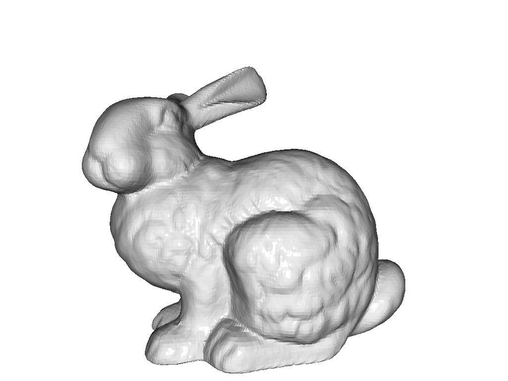

### Stage 7 — LiDAR `.las` ingestion (`day7_laspy_basics.py`)

Write a synthetic LAS 1.4 scene (ground / building / vegetation plus a vehicle block) with ASPRS `classification` codes and `intensity`. Read it back with `laspy`, inspect the header and per-class distribution, and convert it into a colour-coded Open3D cloud. ASPRS has no dedicated vehicle code, so the vehicle points carry code `0` (*unclassified*), which is what the script prints. Intensity (laser return strength) tracks material: metal vehicles reflect more strongly than vegetation.

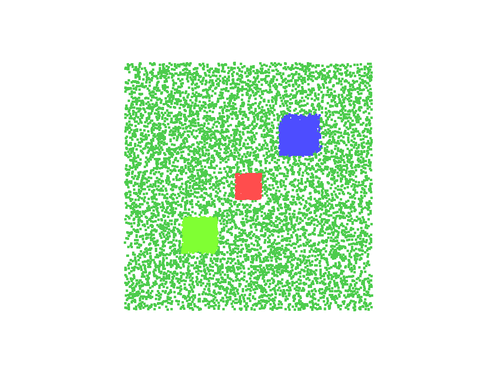 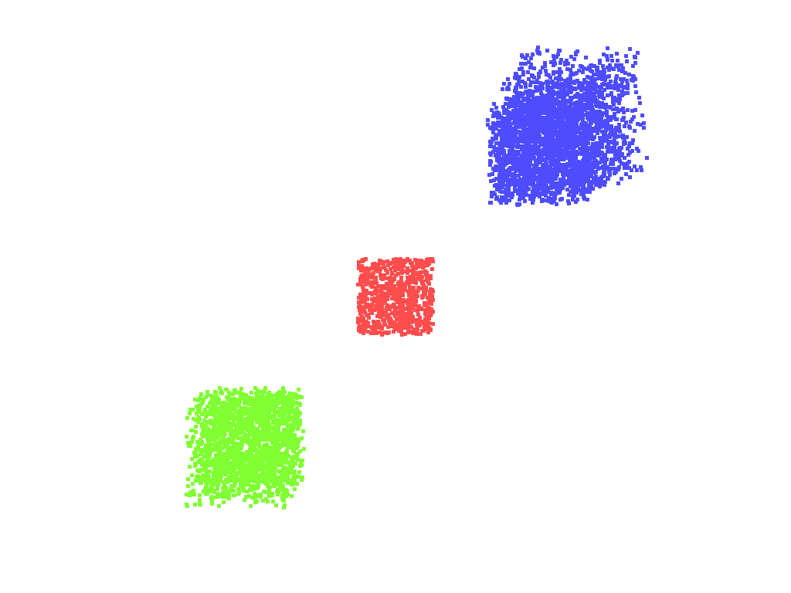

*Left: full scene coloured by classification. Right: ground class removed.*

## Results

Representative numbers from a single run (`python dayN_*.py`). No run log is committed to the repo.

| Stage | Metric | Value |
|-------|--------|-------|
| 1 | Voxel downsample (`voxel_size=0.005`), Stanford Bunny | 100,000 → ~3,130 pts (~96.9% reduction) |
| 2 | Statistical removal (`nb=20, std=2.0`) | 248 / 3,549 pts removed (~7.0%) |
| 2 | Radius removal (`nb=16, r=0.02`) | 233 / 3,549 pts removed (~6.6%) |
| 3 | RANSAC ground plane normal, synthetic scene | ≈ (0.00, 0.00, 1.00) |
| 3 | Ground vs. object split | 4,990 ground / 1,310 object pts |
| 3 | DBSCAN (`eps=0.3, min_points=10`) | 3 clusters (774 / 291 / 187 pts), 58 noise |
| 4 | ICP, exact 15° rotation + (tx, ty, tz) = (0.05, 0.03, 0.01) offset in Bunny model units, no noise (point-to-point and point-to-plane) | fitness 1.0000, rmse 0.000000 (sanity check only) |
| 5 | Poisson mesh (`depth=9`) | 15,474 verts → 14,759 after 5% density trim |
| 6 | Bunny mesh QA | watertight **False**, winding **True**, 223 boundary edges, 1 component |
| 7 | Synthetic LAS scene | 13,800 pts; ground 58.0% / building 21.7% / vegetation 14.5% / unclassified (vehicle stand-in) 5.8% |

Caveats:

- Stages that sample points from the Bunny surface use Open3D's sampler, which is **not** seeded, so their point counts vary by a few percent between runs.
- Both synthetic-scene stages start from a seeded point cloud, but only **Stage 7** is fully reproducible.
- Stage 3's RANSAC plane fit (`segment_plane`) and DBSCAN are themselves unseeded, so its ground/object split and noise count also vary a few percent run-to-run (e.g. ground ranges ~4,930–4,990). The DBSCAN cluster count (3) stays stable; only the split, the exact cluster sizes and the noise count drift. The table above is the single source for cluster sizes.

## Installation notes

Requires Python 3.10 (Open3D 0.19 wheels target 3.8–3.12). Runtime deps are pinned in `requirements.txt`; `requirements-dev.txt` adds `pytest` and `ruff`. The first Bunny-based run downloads the Stanford Bunny (~3 MB) into `~/open3d_data` and caches it.

## Running the stages

Each script opens interactive Open3D viewer windows (drag = rotate, right-drag = pan, scroll = zoom, `Q` = close the window and advance):

```bash
python day1_pointcloud_basics.py
python day3_ransac_dbscan.py
# ... through day7_laspy_basics.py
```

**Headless mode** (no display required) renders the same scenes off-screen to PNG files instead. This is how every figure above was produced. Each stage accepts `--headless` and `--out-dir`:

```bash
# regenerate one stage's figures
python day3_ransac_dbscan.py --headless --out-dir figures

# regenerate every stage's figures
for d in day*.py; do python "$d" --headless --out-dir figures; done
```

## Tests and CI

The tests run with no display and no downloads. They build a tiny synthetic scene in memory and check invariants instead of exact images: voxel downsampling reduces the point count, the biggest RANSAC plane is flat and is the ground, DBSCAN finds objects after ground removal, and the Open3D–trimesh round trip keeps vertex and face counts. There are 5 test functions in `tests/test_smoke.py`.

```bash
pytest -q          # run the smoke tests
ruff check .       # lint
```

GitHub Actions runs `ruff` and `pytest` on every push (see `.github/workflows/ci.yml`).

## Repository layout

```
o3d_utils.py                 # shared helpers (loaders, conversions, headless render)
day1_pointcloud_basics.py    # voxel downsample + normals
day2_outlier_removal.py      # statistical vs. radius denoising
day3_ransac_dbscan.py        # ground segmentation + clustering
day4_icp.py                  # registration
day5_mesh_reconstruction.py  # Poisson meshing
day6_trimesh_basics.py       # mesh quality validation
day7_laspy_basics.py         # LiDAR .las ingestion
tests/test_smoke.py          # headless invariant tests
figures/                     # rendered result screenshots (committed)
requirements*.txt            # pinned runtime / dev dependencies
```

## Relevance to robotics perception

The same primitives reappear throughout robotics. Voxel filtering and outlier removal precede almost every point-cloud pipeline. RANSAC plane removal plus clustering is a standard ground-detection / proposal step. ICP is the backbone of scan registration and LiDAR odometry. Surface reconstruction and mesh validation feed mapping, simulation and digital-twin authoring. `.las` I/O is how real aerial and automotive LiDAR enters any of it. Working each one through in isolation was the point.

## Not implemented

- Swapping the synthetic scenes for a real public LiDAR tile.
- Adding noise and partial overlap to make ICP non-trivial.
- Benchmarking timings per stage.

## References

- Open3D documentation & tutorials — https://www.open3d.org/docs/release/tutorial/
- Fischler & Bolles, *RANSAC* (1981)
- Ester et al., *DBSCAN* (1996)
- Besl & McKay, *A Method for Registration of 3-D Shapes* (ICP, 1992)
- Kazhdan, Bolitho & Hoppe, *Poisson Surface Reconstruction* (2006)
- ASPRS LAS specification — classification codes & point formats
